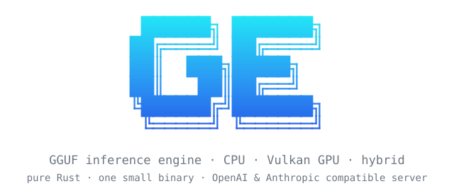
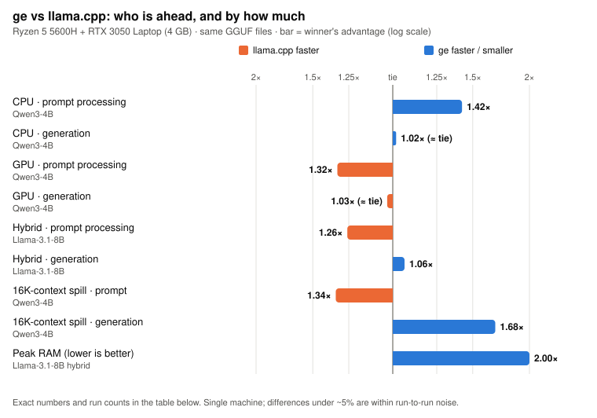
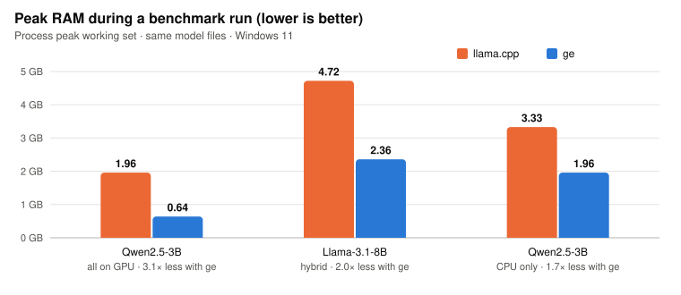
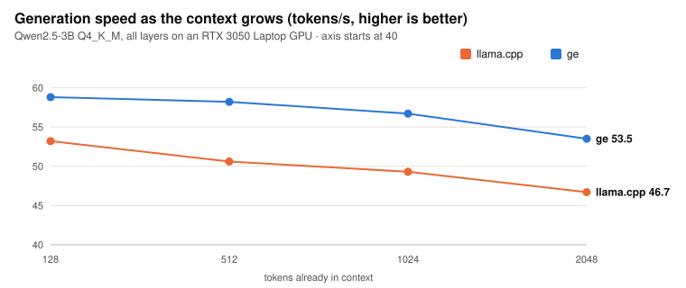
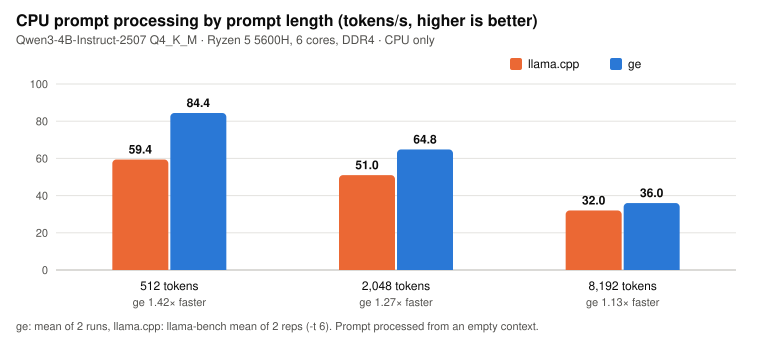
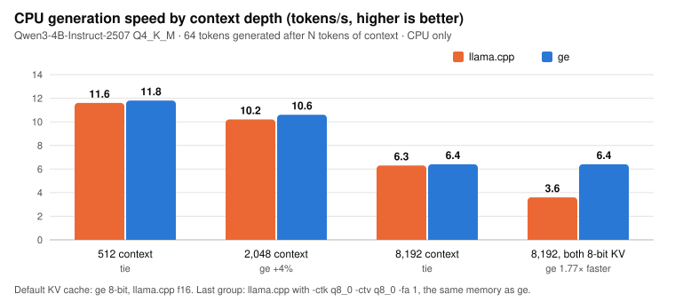

<p align="center">
  
</p>

<p align="center">
  <a href="https://github.com/Ad74751/ge/releases"></a>
  <a href="LICENSE"></a>
  <a href="SECURITY.md"></a>
  
  
  
</p>

**ge** runs GGUF language models (the format used by llama.cpp, Ollama and LM Studio) on your CPU,
your GPU, or both at once. It is a single ~4 MB executable written in Rust, with its own CPU
kernels, its own Vulkan GPU kernels, and a built-in OpenAI- and Anthropic-compatible server.

> **Alpha release.** ge works and is tested, but it has been benchmarked on one laptop and a handful
> of models. Expect rough edges, and please [report what you find](https://github.com/Ad74751/ge/issues).

## Why ge

- **Less memory.** Peak RAM is 1.7–3.1× lower than llama.cpp on the same models, which matters on
  8–16 GB machines.
- **Big models on small GPUs.** A built-in planner measures your machine and splits the model
  between CPU and GPU automatically. An 8B model runs on a 4 GB laptop GPU without trial and error.
- **One file, nothing else.** No Python, no CUDA toolkit, no DLLs next to it. Vulkan is used on any
  GPU vendor through the driver you already have.
- **Ready to serve.** `ge serve` speaks the OpenAI and Anthropic APIs, batches many users into the
  same GPU steps, and can serve two models at once.
- **Fast on plain CPUs.** Prompts are processed 1.13–1.42× faster than llama.cpp on the CPU, with
  the same generation speed using half the threads and half the KV-cache memory.
- **Honest numbers.** Every claim below comes from a run you can reproduce with one command, and
  the places where llama.cpp is faster are listed too.

## Quick start

1. **Download** `ge` for your platform from the [latest release](https://github.com/Ad74751/ge/releases)
   and unzip it.
2. **Get a model** in GGUF format, for example a `Q4_K_M` file of
   [Qwen3-4B-Instruct-2507](https://huggingface.co/models?search=Qwen3-4B-Instruct-2507%20GGUF) or
   [Llama-3.1-8B-Instruct](https://huggingface.co/models?search=Llama-3.1-8B-Instruct%20GGUF) from Hugging Face.
3. **Run it:**

```bash
ge chat -m Qwen3-4B-Instruct-2507-Q4_K_M.gguf
```

The first run tunes ge for your CPU (a few seconds) and writes a repacked copy of the weights next
to the model (`model.gguf.gecache`, about the size of the model) so later starts take about a
second. Use `--no-cache` if you would rather not spend the disk space.

**Is it safe to run?** ge makes no network connections (no telemetry, no update checks), needs no
installer or admin rights, and only writes the cache files listed in [SECURITY.md](SECURITY.md),
which also shows how to verify the download and check this yourself. The Windows binary isn't
code-signed yet, so SmartScreen may warn about an unknown publisher. ge picks CPU, GPU or a CPU+GPU split by itself; `ge devices` shows what it found.

## Benchmarks

Measured on one laptop: AMD Ryzen 5 5600H (6 cores, DDR4), NVIDIA RTX 3050 Laptop GPU (4 GB),
Windows 11, against llama.cpp build 9102 with the same GGUF files. Higher is better unless noted.

<p align="center"></p>

| Workload | Model | llama.cpp | ge | Ahead |
|---|---|---:|---:|---|
| CPU, prompt processing (512 tokens) | Qwen3-4B Q4_K_M | 59.4 tok/s | **84.4 tok/s** | ge, 1.42× |
| CPU, generation | Qwen3-4B Q4_K_M | 11.6 tok/s | 11.8 tok/s | tie (ge +2%) |
| GPU, prompt processing (512 tokens) | Qwen3-4B Q4_K_M | **1,282 tok/s** | 968 tok/s | llama.cpp, 1.32× |
| GPU, generation | Qwen3-4B Q4_K_M | 43.0 tok/s | 41.8 tok/s | tie (llama.cpp +3%) |
| CPU+GPU hybrid, prompt processing | Llama-3.1-8B Q4_K_M | **535 tok/s** | 425 tok/s | llama.cpp, 1.26× |
| CPU+GPU hybrid, generation | Llama-3.1-8B Q4_K_M | 13.0 tok/s | 13.8 tok/s | ge, 1.06× |
| 16K context that overflows 4 GB VRAM, prompt | Qwen3-4B Q4_K_M | **960 tok/s** | 719 tok/s | llama.cpp, 1.34× |
| 16K context that overflows 4 GB VRAM, generation | Qwen3-4B Q4_K_M | 22 tok/s | **37 tok/s** | ge, 1.68× |
| Peak RAM, hybrid (lower is better) | Llama-3.1-8B Q4_K_M | 4.72 GB | **2.36 GB** | ge, 2.0× less |

<p align="center"></p>

<p align="center"></p>

**Where llama.cpp is still ahead.** On NVIDIA GPUs llama.cpp processes prompts 25–35% faster: it uses
an NVIDIA-only Vulkan extension (`VK_NV_cooperative_matrix2`) that ge's shader compiler can't use yet.
It also supports far more model architectures, quantization types and backends (CUDA, Metal, ROCm),
and has been tested by many more people.

**How these were measured.** llama.cpp numbers come from `llama-bench` (2 repeats) or
`llama-server`. ge's 8B numbers are the median of 5 runs; the Qwen3-4B CPU rows are means of 2 runs and the GPU rows
single runs, so treat gaps under ~5% as ties. In the hybrid rows, ge's planner put 22 of 32 layers on the
GPU; llama.cpp ran at `-ngl 21`, its fastest setting that fits (at 22 it runs out of VRAM and drops
to 4 tok/s). The 16K row compares the same 33-layer GPU split, with llama.cpp's KV cache in RAM
because it fails to allocate it in VRAM. Full details, caveats and older runs:
[docs/COMPARISON.md](docs/COMPARISON.md).

### CPU only

No GPU? ge was built CPU-first. On the same 6-core laptop CPU, with prompts and conversations from
512 to 8,192 tokens:

<p align="center"></p>
<p align="center"></p>

- **Faster prompts at every length:** 1.42× llama.cpp at 512 tokens, 1.27× at 2,048 and 1.13× at
  8,192. That's the wait before every answer starts: a 2,048-token prompt takes 32 s instead of 40 s.
- **Same generation speed with half the threads:** generation on a CPU is limited by RAM speed, and
  both engines reach it. ge's auto-tuner gets there with 3 threads instead of 6, leaving cores free.
- **Half the KV memory at no speed cost:** ge keeps the conversation's KV cache in 8-bit by default.
  llama.cpp can do the same, but on this CPU it then generates 1.77× slower than ge at 8,192 tokens of context.
- **Faster edits:** prompt-lookup decoding adds 37–46% generation speed when the answer repeats the
  prompt, such as editing code (off in all benchmark numbers here).

Full numbers, memory per context length and the commands to reproduce: [docs/CPU_BENCHMARKS.md](docs/CPU_BENCHMARKS.md).

### Benchmark your own machine

One command runs the same workload on your CPU, each GPU and the automatic placement, then prints a
report and writes Markdown and JSON copies:

```bash
ge bench-all -m Llama-3.1-8B-Instruct-Q4_K_M.gguf --runs 5 --out my-results
```

Example output (the 8B run behind the table above):

```
  Mode             Device           Placement            Prefill tok/s  vs CPU  Decode tok/s  vs CPU  Peak RAM     VRAM
  ─────────────────────────────────────────────────────────────────────────────────────────────────────────────────────
  CPU only         CPU              CPU                       44.0 ±6%    1.0x       7.5 ±7%    1.0x   4.90 GB        -
  GPU, all layers  RTX 3050 Laptop  does not fit: needs 4.62 GB of VRAM, 3.53 GB free
  Auto (planner)   RTX 3050 Laptop  hybrid 22/32 on GPU      424.9 ±9%    9.7x      13.8 ±14%   1.8x   1.89 GB  3.74 GB
```

Please share your results in a [benchmark issue](https://github.com/Ad74751/ge/issues/new?template=benchmark.yml);
see [BENCHMARKING.md](BENCHMARKING.md) for the rules that keep results comparable.

## Serve an API

```bash
ge serve -m Qwen3-4B-Instruct-2507-Q4_K_M.gguf --alias qwen -np 4 -c 4096 --port 8080
```

Any OpenAI or Anthropic client can then point at `http://127.0.0.1:8080`:

```bash
curl http://127.0.0.1:8080/v1/chat/completions -H "content-type: application/json" \
  -d '{"model": "qwen", "messages": [{"role": "user", "content": "Hello!"}], "stream": true}'
```

```python
from openai import OpenAI
client = OpenAI(base_url="http://127.0.0.1:8080/v1", api_key="unused")
print(client.chat.completions.create(model="qwen", messages=[{"role": "user", "content": "Hello!"}]).choices[0].message.content)
```

| Endpoint | API |
|---|---|
| `POST /v1/chat/completions` | OpenAI Chat Completions, streaming and non-streaming |
| `POST /v1/completions` | OpenAI text completions |
| `POST /v1/messages` | Anthropic Messages, streaming and non-streaming |
| `POST /v1/messages/count_tokens` | Anthropic token counting |
| `GET /v1/models`, `GET /health` | model list; slots, active and queued requests |

- `-np N` decodes N users together: each step reads the weights once for all of them. On the 8B,
  4 concurrent users get 28 tok/s in total vs 11 tok/s for one user.
- Repeated prompt prefixes (system prompts, earlier chat turns) are reused instead of recomputed.
- Pass `-m` twice to serve two models at once; CPU cores and VRAM are split between them.
- `--api-key KEY` (or `GE_API_KEY`) requires `Authorization: Bearer KEY` or `x-api-key: KEY`.
- The server listens on `127.0.0.1` by default. Use `--host 0.0.0.0` only together with `--api-key`.

## Commands

| Command | What it does |
|---|---|
| `ge chat -m MODEL` | interactive chat (`/reset`, `/exit`) |
| `ge run -m MODEL -p "prompt"` | one answer to one prompt |
| `ge serve -m MODEL` | OpenAI- and Anthropic-compatible HTTP server |
| `ge bench-all -m MODEL` | the same benchmark on CPU, each GPU and auto placement, as a report |
| `ge bench -m MODEL` | prompt-processing and generation speed for one configuration |
| `ge perplexity -m MODEL -f text.txt` | perplexity, comparable with `llama-perplexity` |
| `ge devices` | the Vulkan GPUs ge can use |
| `ge selftest` | checks every CPU and GPU kernel against a reference on this machine |
| `ge info -m MODEL` | model metadata and tensor types |

Common options: `-c` context length, `-n` max new tokens, `-ngl N|all|auto` GPU layers, `--cpu`,
`--gpu ID`, `-t` threads, `--temp --top-k --top-p --min-p --seed`. Run `ge` with no arguments for all of them.

## Context window

ge supports each model's full context length (for example 262,144 tokens for Qwen3-4B-Instruct-2507,
131,072 for Llama-3.1-8B). Set it with `-c`:

```bash
ge chat  -m Qwen3-4B-Instruct-2507-Q4_K_M.gguf -c 32768          # a 32K-token conversation
ge serve -m Qwen3-4B-Instruct-2507-Q4_K_M.gguf -c 16384 -np 4    # 16K tokens for each of 4 users
```

- **The 4,096-token default is not a limit.** `ge chat`, `ge run` and `ge serve` start at 4,096 tokens
  (per user for `serve`) only to keep memory use low. Raise it with `-c`.
- **Memory is the real limit.** Every token of context needs KV-cache memory. ge stores it in 8-bit,
  about half of llama.cpp's default: for Qwen3-4B, 32K tokens take 2.6 GB with ge vs 4.8 GB in f16.
  On a GPU, a context that doesn't fit in VRAM is split with the CPU automatically.
- **Longer context is slower in every engine.** Each new token reads the whole conversation, so at
  8,192 tokens generation is about 45% slower than at 512, in ge and llama.cpp alike. The benchmarks
  above include 8K-context results for that reason, not just short prompts.

## What runs

- **Model families:** Llama 2/3.x, Mistral, Mixtral (MoE), Qwen2/2.5/3 (dense and MoE), Gemma 1/2/3 (Gemma 3 lightly
  tested), Phi-3.
- **Quantizations:** F32, F16, BF16, Q4_0, Q4_1, Q5_0, Q5_1, Q8_0, Q2_K–Q6_K, IQ4_NL, IQ4_XS.
- **CPUs:** x86-64 with AVX2 (AVX-VNNI and AVX-512-VNNI kernels are included but untested on
  real hardware). ARM is not supported yet.
- **GPUs:** NVIDIA, AMD and Intel GPUs with a recent Vulkan driver (Vulkan 1.1 or newer with
  subgroup operations; 1.3 recommended). Tensor cores are used where the driver exposes
  `VK_KHR_cooperative_matrix`. Without a usable GPU, ge runs on the CPU.
- **Operating systems:** Windows 10/11 and Linux. macOS needs MoltenVK and is untested.

On Linux, GPU support needs the Vulkan loader and your GPU's Vulkan driver (for example the
`libvulkan1` and `mesa-vulkan-drivers` packages, or the NVIDIA driver). WSL2 exposes only a software
renderer unless Mesa's Dozen driver is installed, so use the Windows build for GPU work there.

## Source code

The source code isn't public during the alpha; the binaries are built from a private
repository. Feedback, bug reports and benchmark results are very welcome in the meantime.

## Documentation

- [docs/COMPARISON.md](docs/COMPARISON.md): full comparison with llama.cpp, including where ge loses
- [docs/CPU_BENCHMARKS.md](docs/CPU_BENCHMARKS.md): CPU-only results at 512 to 8,192 tokens of context
- [BENCHMARKING.md](BENCHMARKING.md): how to benchmark and submit results
- [benchmark-schema.json](benchmark-schema.json): the JSON format written by `ge bench-all --out`
- [CHANGELOG.md](CHANGELOG.md): what changed in each release
- [SECURITY.md](SECURITY.md): what ge does on your machine, and how to verify it
- [THIRD_PARTY_NOTICES.txt](THIRD_PARTY_NOTICES.txt): open-source components included in ge

## Known limitations

- Prompt processing on NVIDIA GPUs trails llama.cpp by 25–35% (see above).
- The first prompt after loading a model in CPU+GPU hybrid mode can be slower than later ones while
  the OS file cache warms up.
- Chat templates are matched to known families rather than run as Jinja; unusual templates may need `--raw`.
- Not yet supported: YaRN RoPE scaling, IQ1/IQ2/IQ3 quantizations, tool calling and images in the
  server, ARM CPUs.

## License and author

The binaries are free to use for personal and commercial purposes, see [LICENSE](LICENSE). Open-source
components included in ge are listed in [THIRD_PARTY_NOTICES.txt](THIRD_PARTY_NOTICES.txt). Created by [Ad74751](https://github.com/Ad74751).
The GPU matrix-multiply design follows llama.cpp's Vulkan backend; thanks to the llama.cpp and
ggml authors for the GGUF format and their open work.
