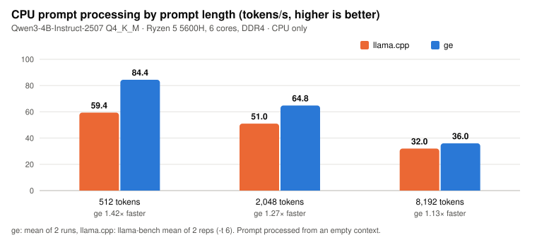
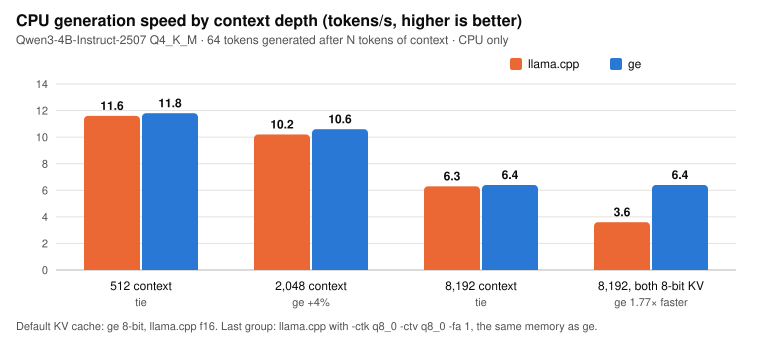

# CPU benchmarks

ge was built CPU-first: its CPU engine has its own int8 matrix kernels, a per-machine auto-tuner,
and an 8-bit KV cache by default. This page compares it with llama.cpp on the CPU alone, at three
context lengths, so you can see how both behave as prompts and conversations get longer.

**Test machine:** an ASUS Vivobook laptop (model M6500QC) with an AMD Ryzen 5 5600H (6 cores / 12
threads, Zen 3, 3.3–4.2 GHz, AVX2, 45 W default TDP) and 16 GB of dual-channel DDR4-3200 (about
30 GB/s measured), Windows 11 (build 26300), plugged in, Balanced power plan. No GPU used. Full
specs: [README](../README.md#test-machine).
**Model:** Qwen3-4B-Instruct-2507, `Q4_K_M` (2.5 GB), the same file for both engines.
**Versions:** ge v0.1.0-alpha.1, llama.cpp build 9102. Measured 12 Nov 2026, back to back.

## Results

<p align="center"></p>

<p align="center"></p>

**Prompt processing**: an N-token prompt processed from an empty context (tokens/s).

| Prompt length | llama.cpp | ge | ge vs llama.cpp |
|---:|---:|---:|---|
| 512 | 59.4 | **84.4** (79.0, 89.7) | **1.42× faster** |
| 2,048 | 51.0 | **64.8** (63.5, 66.0) | **1.27× faster** |
| 8,192 | 32.0 | **36.0** (35.8, 36.1) | **1.13× faster** |

**Generation**: 64 tokens generated after N tokens of context (tokens/s).

| Context | llama.cpp (f16 KV) | ge (8-bit KV) | ge vs llama.cpp |
|---:|---:|---:|---|
| 512 | 11.6 | 11.8 (11.3, 12.4) | tie |
| 2,048 | 10.2 | 10.6 (10.5, 10.6) | ge +4% |
| 8,192 | 6.3 | 6.4 (6.4, 6.5) | tie |
| 8,192, both with 8-bit KV | 3.6 | **6.4** | **ge 1.77× faster** |

ge numbers are the mean of 2 runs (individual runs in brackets). llama.cpp numbers are the mean of
2 `llama-bench` repetitions with its default 6 threads; its spread was under 2%.

## What this shows

**1. ge processes prompts faster on the CPU, at every length tested.** The lead is largest on
typical prompts (1.42× at 512 tokens) and shrinks on very long ones (1.13× at 8,192), because at
long lengths more of the time goes into attention rather than the weight matrices where ge's
int8 kernels win. Prompt speed is what you wait for before the first word of every answer: with a
2,048-token prompt (a long question plus a document), ge starts answering after about 32 seconds
on this CPU, llama.cpp after about 40.

**2. Generation speed is a tie, as it should be.** Generating one token at a time on a CPU is limited
by how fast weights stream from RAM (about 30 GB/s here), not by the engine. Both engines reach that
limit, so neither can pull ahead by much.

**3. ge saves memory without losing speed.** ge keeps its KV cache (the memory that holds the
conversation so far) in 8-bit by default, about half the size of llama.cpp's default f16 cache,
at the same speed. llama.cpp can also store its KV cache in 8-bit, but on this CPU that makes it
43% slower at 8,192 tokens of context (3.6 vs 6.3 tok/s). At the same memory use, ge generates
1.77× faster. The quality cost is negligible: on Qwen2.5-0.5B, CPU perplexity was 5.8560 with ge's
8-bit cache and 5.8526 with an f16 value cache (a 0.06% difference), and on the GPU, Qwen2.5-3B
measured 4.2078 with 8-bit vs 4.2081 with f16.

**4. ge does it with half the threads.** ge's auto-tuner found that generation on this CPU stops
getting faster beyond 3 threads, so ge uses 3 for generation (and all 6 for prompts). It matches
llama.cpp's 6-thread speed and leaves the other cores free for your other programs. Run with 3
threads, llama.cpp drops to 5.8 tok/s at 8,192 context (ge: 6.4).

**5. Smaller models.** In earlier tests (an older ge build, 10 Nov 2026), ge's CPU lead was larger on
small models: Qwen2.5-0.5B Q4_0 processed prompts at 500–596 tok/s vs 334–379 and generated at
77–85 vs 63–79; Llama-3.2-1B Q4_K_M at 249–281 vs 193–198 and 36–38 vs 33 tok/s.

**6. Prompt-lookup decoding for editing tasks.** When the answer repeats text from the prompt
(editing code, rewriting a document), ge drafts tokens from the prompt and checks them in one
batch. In those earlier tests this added 37–46% generation speed on editing prompts (Llama-3.2-1B:
38.6 → 52.8 tok/s) with identical output. It's on by default in `ge chat` and `ge run`; it's off in
all the benchmark numbers above, which are plain generation.

## Context window

**How long can the context be?** Up to the model's own limit: Qwen3-4B-Instruct-2507 supports
262,144 tokens, Llama-3.1-8B 131,072. The real limit is your RAM, because the KV cache grows with
every token. Set the size with `-c`:

```bash
ge chat -m Qwen3-4B-Instruct-2507-Q4_K_M.gguf -c 32768              # 32K-token conversation
ge serve -m Qwen3-4B-Instruct-2507-Q4_K_M.gguf -c 16384 -np 4       # 16K tokens for each of 4 users
```

`ge chat` and `ge run` default to 4,096 tokens (or less if the model's limit is lower), and
`ge serve` to 4,096 per user. That default is only a memory-saving starting point, not a limit
of ge.

**How much memory does a long context need?** The KV cache for Qwen3-4B, on top of the model itself:

| Context | f16 KV (llama.cpp default) | 8-bit KV (ge default) |
|---:|---:|---:|
| 4,096 | 0.60 GB | 0.32 GB |
| 8,192 | 1.21 GB | 0.64 GB |
| 32,768 | 4.83 GB | 2.57 GB |
| 131,072 | 19.3 GB | 10.3 GB |
| 262,144 (model max) | 38.7 GB | 20.5 GB |

These are calculated from the model's shape (36 layers, 8 KV heads of 128 values: 147 KB per token
in f16, 78 KB in 8-bit). Measured, ge's peak RAM in the runs above was 2.69 GB at 512 tokens,
2.83 GB at 2,048 and 3.42 GB at 8,192, including the 2.5 GB model; switching ge to an f16 cache
at 8,192 tokens raised it to 3.95 GB (single run), close to the calculated difference
(0.53 GB measured vs 0.57 GB calculated). On a 16 GB laptop, ge's
8-bit cache is the difference between a 32K context fitting comfortably and not.

**Does it get slower with more context?** Yes, in every engine. Each new token has to look at the
whole conversation so far, so on this CPU generation runs about 45% slower at 8,192 tokens of
context than at 512 (6.4 vs 11.8 tok/s in ge, 6.3 vs 11.6 in llama.cpp). Short benchmarks flatter
every engine; the 8,192-token rows above are closer to a long chat or a document question.

## Reproduce

```bash
# ge: prompt processing and generation at one context length (repeat for 512, 2048, 8192)
ge bench -m Qwen3-4B-Instruct-2507-Q4_K_M.gguf --cpu --pp 2048 --tg 64

# llama.cpp: prompt processing from an empty context, and generation at a given depth
llama-bench -m Qwen3-4B-Instruct-2507-Q4_K_M.gguf -ngl 0 -dev none -p 512,2048,8192 -n 0 -r 2
llama-bench -m Qwen3-4B-Instruct-2507-Q4_K_M.gguf -ngl 0 -dev none -p 0 -n 64 -d 512,2048,8192 -r 2

# llama.cpp with the same 8-bit KV cache as ge
llama-bench -m Qwen3-4B-Instruct-2507-Q4_K_M.gguf -ngl 0 -dev none -p 0 -n 64 -d 8192 -ctk q8_0 -ctv q8_0 -fa 1 -r 2
```

**Limits of this comparison:** one CPU (Zen 3 with AVX2), one model, two runs per point, Windows
with normal background programs running. CPUs with AVX-512 or AVX-VNNI, Intel hybrid CPUs and
Linux may behave differently. llama.cpp's peak RAM wasn't measured in this run, so memory is
compared through the KV cache sizes above. Results from other machines are very welcome:
see [BENCHMARKING.md](../BENCHMARKING.md).
